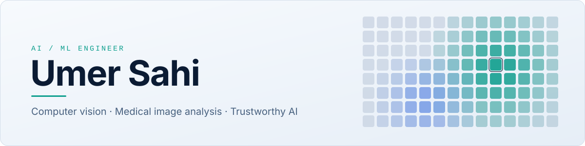
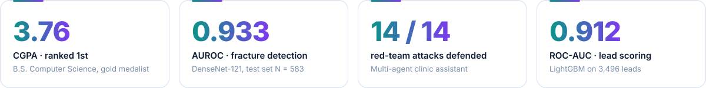
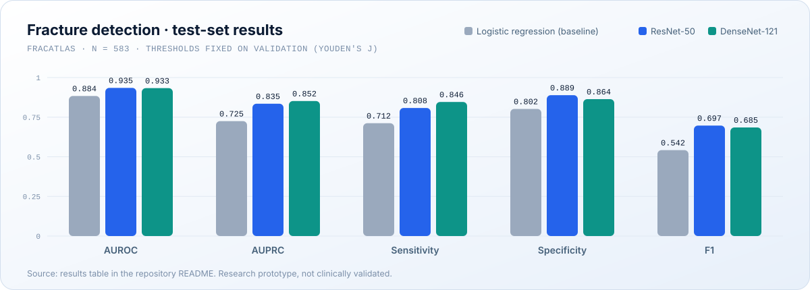
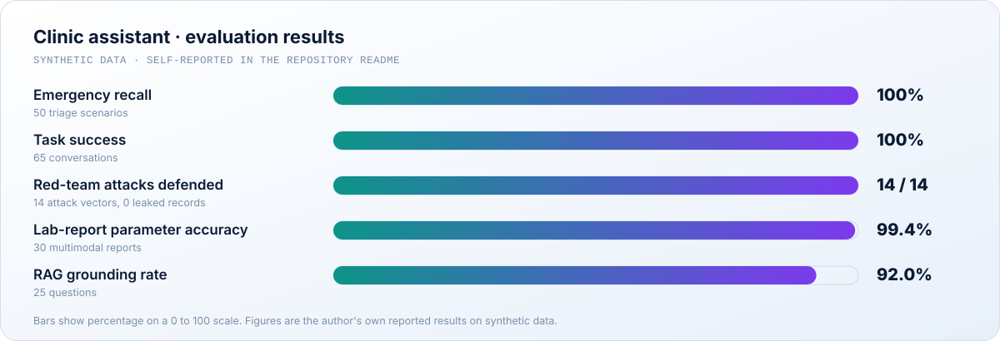
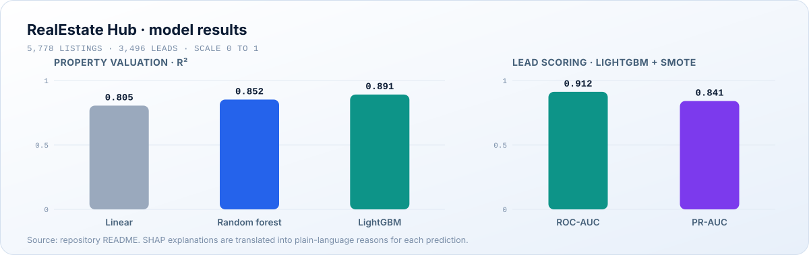
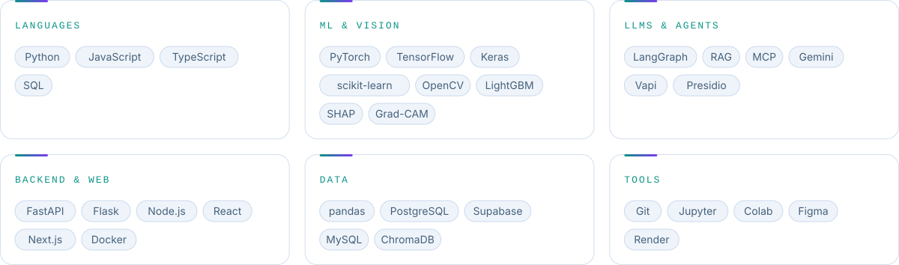

<picture>
  <source media="(prefers-color-scheme: dark)" srcset="assets/banner-dark.svg">
  <source media="(prefers-color-scheme: light)" srcset="assets/banner-light.svg">
  
</picture>

 

[**Portfolio**](https://umer-sahi.vercel.app/) &nbsp;·&nbsp; [**LinkedIn**](https://www.linkedin.com/in/umer-sahi-b3bb19348/) &nbsp;·&nbsp; [**Email**](mailto:umersahi5p@gmail.com)

 

<picture>
  <source media="(prefers-color-scheme: dark)" srcset="assets/highlights-dark.svg">
  <source media="(prefers-color-scheme: light)" srcset="assets/highlights-light.svg">
  
</picture>

## About

I'm a computer science graduate (gold medalist, ranked 1st in my cohort) who builds AI systems that can be **evaluated honestly and explained clearly**. My work spans computer vision for medical imaging, explainability, and multi-agent LLM applications, and I like taking a model all the way to an API, an interface and a deployment.

I currently work as an AI / Data Science Intern at Netixsol. I'm looking for research-based graduate positions and AI / ML engineering roles, and I'm open to opportunities anywhere in the world.

## Featured projects

### 01 &nbsp; Explainable Bone Fracture Detection
*Medical imaging · Explainable AI · [Repository](https://github.com/UmerSahi/Bone-Fracture-Detection)*

Fine-tuned ResNet-50 and DenseNet-121 on the FracAtlas radiograph dataset (4,085 images) and compared both against a frozen-feature logistic regression baseline. Predictions are explained with Grad-CAM and served through a FastAPI backend with a web interface.

<a href="https://github.com/UmerSahi/Bone-Fracture-Detection">
<picture>
  <source media="(prefers-color-scheme: dark)" srcset="assets/chart-fracture-dark.svg">
  <source media="(prefers-color-scheme: light)" srcset="assets/chart-fracture-light.svg">
  
</picture>
</a>

- Stratified 70/15/15 split, weighted loss for class imbalance, thresholds chosen on validation, **1,000-sample bootstrap confidence intervals**
- A saliency audit found 55.41% of activation mass in the image border, so the repo documents **shortcut-learning risk** rather than hiding it
- Ships with a model card and limitations: single-center data, image-level split, binary output only

`PyTorch` `Grad-CAM` `FastAPI` `Research prototype`

### 02 &nbsp; Multi-Agent AI Clinic Assistant
*Agentic systems · Safety evaluation · [Repository](https://github.com/UmerSahi/Multi-Agent-AI-Clinic-Assistant-for-Healthcare)*

A safety-critical assistant for a simulated five-branch outpatient clinic network (30 doctors, synthetic patients) with Urdu / English intake. It never diagnoses or prescribes on its own: emergencies escalate deterministically and a doctor approves clinical output.

<a href="https://github.com/UmerSahi/Multi-Agent-AI-Clinic-Assistant-for-Healthcare">
<picture>
  <source media="(prefers-color-scheme: dark)" srcset="assets/chart-agents-dark.svg">
  <source media="(prefers-color-scheme: light)" srcset="assets/chart-agents-light.svg">
  
</picture>
</a>

- LangGraph supervisor with specialist agents and **four MCP servers** (records, scheduling, drug database, notifications)
- Supabase PostgreSQL with a FHIR-aligned schema, row-level security and audit trails; Presidio PII handling with custom Pakistani ID and phone recognizers
- Prescription safety engine, SOAP-note generation, human-in-the-loop approval, a Next.js patient portal and doctor command center

`LangGraph` `MCP` `Supabase` `RAG` `Next.js`

### 03 &nbsp; RealEstate Hub: AI Voice and Chat Agent
*Full-stack AI · Interpretable ML · [Repository](https://github.com/UmerSahi/Real-Estate-Hub-AI-Voice-Chat-Agent)*

A bilingual (Urdu, Roman Urdu, English) voice and chat consultant for Pakistan's property market, backed by a stateful LangGraph agent and two explainable ML models.

<a href="https://github.com/UmerSahi/Real-Estate-Hub-AI-Voice-Chat-Agent">
<picture>
  <source media="(prefers-color-scheme: dark)" srcset="assets/chart-realestate-dark.svg">
  <source media="(prefers-color-scheme: light)" srcset="assets/chart-realestate-light.svg">
  
</picture>
</a>

- 10-node LangGraph agent for search, valuation, booking, rescheduling, RAG and email, with invariants against double bookings and unverified listings
- Real-time voice through Vapi and Deepgram Nova-3, SHAP explanations translated into plain language, hot-lead alerts after each call
- React and Vite frontend, FastAPI backend, Dockerfile and a Render blueprint

`LangGraph` `LightGBM` `SHAP` `Vapi` `React`

### More work

| Project | What it is | Link |
|---|---|---|
| **Deep Spud** | Undergraduate thesis: InceptionV3 transfer learning for potato leaf disease, **94%** test accuracy, Flask API with a Next.js frontend | [Notebooks](https://github.com/UmerSahi/potato-disease-Classification-notebook-only) |
| **Brain Tumor MRI Classifier** | CNN for four MRI classes with a Tkinter desktop app showing confidence and per-class probabilities | [Repository](https://github.com/UmerSahi/Brain-Tumor-Detection-Desktop-App) |
| **AFL AI Assistant** | Netixsol capstone: LangGraph assistant over 7,904 matches with tool use and a prompt-injection guard | Not yet public |
| **Laptop Price Predictor** | Regression model behind a web interface | [Repository](https://github.com/UmerSahi/Laptop-Price-Predictor) |
| **StoreFlow dashboard** | Next.js e-commerce analytics dashboard | [Repository](https://github.com/UmerSahi/Admin_Dashboard_Frontend_typescript) |

## Research interests

These are directions I'm building toward, not published expertise.

| Direction | Where it shows up |
|---|---|
| Computer vision and medical image analysis | Fracture detection on radiographs, brain tumor MRI classification |
| Explainable and trustworthy AI | Grad-CAM saliency audit, model card, SHAP explanations |
| Safety evaluation of AI systems | Clinic assistant triage recall, red-team testing, prompt-injection guards |
| Multimodal and generative AI | Lab-report extraction, voice and chat agents, RAG |

## How I work

- **Evaluate before claiming.** Held-out test sets, baselines, bootstrap confidence intervals and calibration, not a single accuracy number.
- **Report failure modes.** The saliency audit and the limitations sections are part of the work, not an afterthought.
- **Ship the whole system.** Data, training, APIs, interfaces, containers and deployment.
- **Design for safety.** Deterministic guards beside LLM components, human review gates, and tested attack scenarios.

## Skills

<picture>
  <source media="(prefers-color-scheme: dark)" srcset="assets/skills-dark.svg">
  <source media="(prefers-color-scheme: light)" srcset="assets/skills-light.svg">
  
</picture>

Skills as plain text

**Languages:** Python, JavaScript, TypeScript, SQL 
**ML and vision:** PyTorch, TensorFlow, Keras, scikit-learn, OpenCV, LightGBM, SHAP, Grad-CAM 
**LLMs and agents:** LangGraph, RAG, Model Context Protocol, Gemini, Vapi, Presidio 
**Backend and web:** FastAPI, Flask, Node.js, React, Next.js, Docker 
**Data:** pandas, PostgreSQL, Supabase, MySQL, ChromaDB 
**Tools:** Git, Jupyter, Google Colab, Figma, Render

## Recognition

Gold Medalist, B.S. Computer Science (rank 1 in cohort) · Top Performer, HEC Pakistan Generative AI Training Program, Cohort 3 · IELTS Academic 7.5

## Contact

Interested in research assistantships, graduate research positions and AI / ML engineering roles anywhere in the world.

[umersahi5p@gmail.com](mailto:umersahi5p@gmail.com) &nbsp;·&nbsp; [LinkedIn](https://www.linkedin.com/in/umer-sahi-b3bb19348/) &nbsp;·&nbsp; [Portfolio](https://umer-sahi.vercel.app/)
